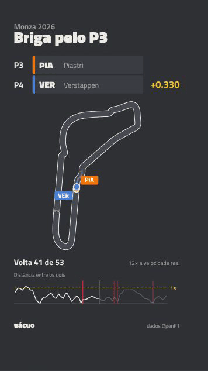

# Vácuo

Finds the best wheel-to-wheel battles of any Formula 1 race and turns each one into a 30-second vertical video. *Vácuo* is Brazilian F1 slang for the slipstream.

<p align="center">
  
</p>

```
$ npm run battles -- monza --top 3

#  Battle      For  Laps   Time   Min gap  Swaps  Score
1  PIA vs VER  P3   38–48  13:44  0.014s   5      37.3
2  PIA vs NOR  P4   43–53  14:34  0.003s   3      31.7
3  HAM vs PIA  P4   23–28  6:59   0.069s   1      12.6

$ npm run clip -- monza
out/monza-2026-pia-ver.mp4
```

## Usage

Requires Node 23.6 or newer, which runs TypeScript directly with no build step.

```
npm install
npm run battles -- las vegas 2023       # rank a race's battles (default: the latest race)
npm run clip -- monza --battle 2        # render battle #2 to out/
npm run clip -- monza --no-render       # only write the clip data, then tweak the video live:
npm run studio -- --props=out/monza-2026-pia-ver.json
npm test
```

## How it works

- **Fetch** timing data from [OpenF1](https://openf1.org), throttled to its free tier, retried on failures, and cached once a race is over.
- **Detect** battles by pairing every gap sample with the car directly ahead and ignoring safety cars, VSCs, red flags and pit stops. A battle starts under 1.0s and only ends past 1.5s, and it is scored by length, position, closeness and overtakes.
- **Clip** up to 324s of race time around the overtakes, always ending on the real outcome, and interpolate both cars' positions for every frame.
- **Render** each frame with [Remotion](https://www.remotion.dev) from that data. The on-screen text is in Brazilian Portuguese.

Built with TypeScript on Node 24, `node:test`, React 19 and Remotion 4.

## License

[MIT](LICENSE)
